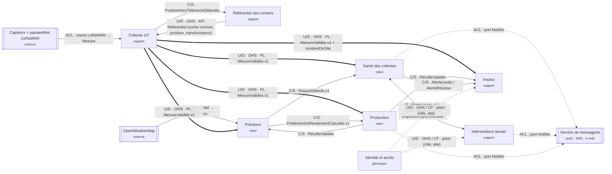

# Context map QueenBee · groupe Data

Binôme : Calixte Nguemo et Jule Rosier · M1 Data

Les flèches doubles (`==>`) portent le livrable de spécialité Data : l'événement
**MesureValidée.v1**, published language de Collecte IoT, contractualisé dans
[`specialite/data-contrat-mesure-validee.md`](specialite/data-contrat-mesure-validee.md).
Identité et accès sert tous les contextes avec interface utilisateur ; deux flèches seulement
sont tracées pour garder le schéma lisible.

## Relations

| Amont | Aval | Relation | Échange | Justification |
|---|---|---|---|---|
| Capteurs + passerelles LoRaWAN | Collecte IoT | ACL | trame LoRaWAN binaire | format imposé par le matériel, susceptible de changer de fournisseur : on ne le laisse pas entrer dans le modèle |
| OpenWeatherMap | Prévision | ACL | relevé météo JSON OWM | API tierce, unités et noms à traduire, quota et pannes à isoler |
| Référentiel des ruchers | Collecte IoT | U/D · OHS | API de lecture (ruche connue, position de référence, transhumances en cours) | référentiel stable consulté par tous, publié une fois pour tous |
| Collecte IoT | Référentiel des ruchers | Customer / Supplier | PositionHorsToléranceDétectée | le Référentiel exprime ce qu'il lui faut (position, ruche, date) pour trancher transhumance ou déplacement non déclaré |
| Collecte IoT | Santé des colonies | U/D · OHS · PL | **MesureValidée.v1** | quatre consommateurs : un contrat versionné unique plutôt qu'une API par client |
| Collecte IoT | Prévision | U/D · OHS · PL | **MesureValidée.v1** | idem ; Prévision consomme aussi l'historique (rejeu du flux) |
| Collecte IoT | Production | U/D · OHS · PL | **MesureValidée.v1** (poids) | le coordinateur compare la récolte aux poids mesurés (UC-C02) |
| Collecte IoT | Impact | U/D · OHS · PL | **MesureValidée.v1**, IncidentDeSite | indicateur de couverture réseau et séries de poids |
| Prévision | Santé des colonies | Customer / Supplier | RisqueDétecté.v1 (type, confiance, ruche) | Santé fixe ses besoins (seuil de confiance, types de risque), Prévision les planifie |
| Prévision | Production | Customer / Supplier | PrédictionDeRendementCalculée.v1 | Production a besoin d'une prédiction par ruche et par saison avant la récolte |
| Production | Prévision | Customer / Supplier | RécolteValidée | vérité terrain pour réentraîner le modèle de rendement |
| Santé des colonies | Interventions terrain | Partnership | AlerteLevée.v1, AlerteEscaladée.v1 ⇄ InspectionSynchronisée | les deux livrent ensemble le cycle alerte → visite → inspection → résolution |
| Production | Impact | Customer / Supplier | RécolteValidée | rendement par site pour les rapports |
| Santé des colonies | Impact | Customer / Supplier | AlerteLevée, AlerteRésolue | indicateur « colonies à risque » |
| Identité et accès | tous les contextes | U/D · OHS, aval Conformist | jeton signé (rôle, site), adapté au hors-ligne | modèle générique pris tel quel par les contextes |
| Santé, Terrain, Production | Service de messagerie | ACL (port Notifier) | notification | le fournisseur de SMS ou de push est remplaçable |

16 relations typées, 3 systèmes externes, 4 couches anticorruption.
